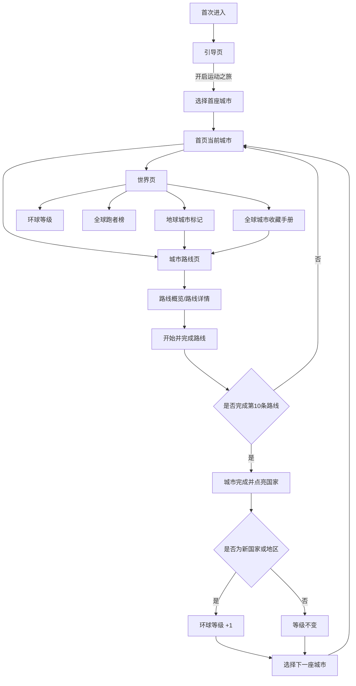
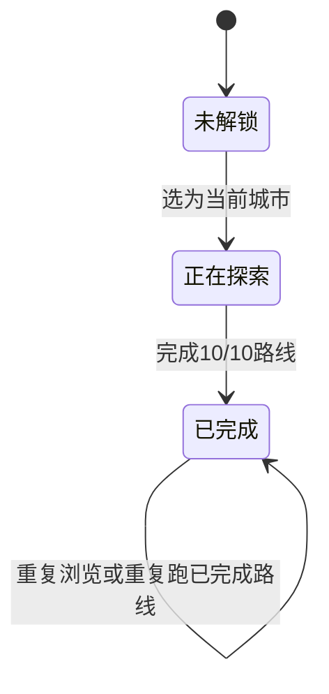

# MOVEVI APP 2.0 改版 PRD

> 文档版本：V2.0  
> 基线版本：当前可运行原型（2026-09-28）  
> 文档状态：评审稿  
> 适用范围：仅描述本轮改动；未改动页面与既有业务能力不重复展开

## 0. 变更范围声明

本轮改版围绕“把每一次真实跑步沉淀为城市足迹、探索进度和环球成就”重组产品叙事与核心浏览路径。

本 PRD 仅覆盖以下页面或模块：

1. 首次进入引导页与首次城市选择。
2. 首页。
3. 世界页。
4. 城市路线页与路线概览。
5. 环球等级。
6. 我的排名（全球跑者榜）。
7. 全球城市收藏手册。
8. 活动页、我的页的 UI 调整。

以下内容不在本轮需求范围内：

- 不重构跑步记录、路线完成、设备连接、奖励、活动和账号等既有数据结构。
- 不新增勋章、等级权益、奖励发放或未知旅程推荐体系。
- 不调整活动页、我的页的核心业务规则。
- 不建设排行榜、城市跑过人数等服务端能力；当前原型数据为演示数据，正式数据源见“待确认项”。

## 1. 项目概述

### 1.1 背景

旧版核心页面以城市与单次路线为主，用户难以快速理解“跑步—完成城市—点亮国家—提升环球等级”的长期成长关系。本轮通过首次引导、首页城市旅程、世界页地球视图、环球等级与城市收藏手册，建立统一的环球旅程心智。

### 1.2 产品目标

- 用户首次进入时，能够理解产品是“跑步版 Google Earth”。
- 用户在首页能够快速选择当前城市、查看进度并继续路线。
- 用户在世界页能够看到已完成国家高亮、环球等级、排名和累计探索结果。
- 用户能够从地球标记、首页城市卡片或全球城市收藏手册进入任意城市路线页。
- 完成城市后，系统能够正确去重点亮国家并提升环球等级。
- 移动端页面内容完整、可滚动、无大面积无效留白，底部导航不遮挡内容。

### 1.3 目标用户

- 使用 MOVEVI 跑步机或走步机进行室内运动的用户。
- 希望通过城市路线、沿途景点和收集进度增强运动持续性的用户。
- 关注个人环球进度、等级与排名的长期用户。

### 1.4 角色与权限

| 角色 | 权限说明 |
|---|---|
| 普通用户 | 浏览全部城市与路线信息；开始已开放路线；查看个人环球等级、排名与探索数据 |
| 未连接设备用户 | 可浏览页面与路线信息；开始跑步时沿用既有设备连接校验 |
| 游客/未登录用户 | [待确认] 当前原型未区分账号态；正式版本需明确浏览、记录和同步权限 |

## 2. 核心规则与主流程

### 2.1 核心业务规则

1. 每座城市包含 10 条路线。
2. 完成城市全部路线后，该城市状态变为“已完成”。
3. 完成一座城市时，点亮其所属国家或地区。
4. 同一国家或地区下完成多座城市，仅首次计入环球等级；例如北京、上海共同计为中国 1 级。
5. 环球等级等于已点亮国家和地区数量，最低 LV.0，最高 LV.195。
6. 城市仅有三种对用户可见的状态：已完成、正在探索、未解锁。
7. 所有城市入口均可进入对应城市路线页；未解锁城市的路线保持只读或锁定，不允许绕过解锁规则开始运动。
8. 路线按 3、6、10 的阶段阈值开放：初始开放 3 条；完成 3 条后开放至 6 条；完成 6 条后逐条开放至第 10 条。
9. 重复完成同一路线不得重复增加路线数、景点数、城市进度或环球等级。
10. 世界页城市目标口径为 20，路线目标口径为 300；当前首批目录含 20 座城市、每城 10 条路线，共 200 条可配置路线。

### 2.2 主流程

### 2.3 状态流转

> 候选城市仅用于系统推荐与选择校验，不作为对用户展示的第四种城市状态。

## 3. 页面与功能需求

## 3.1 首次进入引导页

### 3.1.1 改动目标

用一屏建立“室内跑步也能探索全球城市”的产品认知，并引导用户选择首座城市。

### 3.1.2 页面内容

- 左上展示 MOVEVI 品牌标识；移除右上角版本号与“环球运动旅程”文案。
- 核心视觉为东京、巴黎、纽约三张叠放城市卡片与轨道装饰。
- 辅助标题：“你的环球运动旅程”。
- 主标题：“让你足不出户 / 跑遍全球”，不带逗号、句号或感叹号。
- 说明文案：“选择一座城市作为起点，在运动中解锁路线、探索景点，留下属于你的城市足迹。”
- 展示三个能力标签：城市路线、沿途景点、运动记录。
- 主按钮：“开启运动之旅”。

### 3.1.3 交互

1. 点击“开启运动之旅”后，以翻转/切换方式进入首次城市选择。
2. 首次城市选择必须先选中城市，主按钮才可用。
3. 点击“从{城市名}出发”后创建该城市的初始旅程并进入首页。
4. 支持键盘焦点、回车/空格触发与系统减少动态效果。

### 3.1.4 边界状态

| 场景 | 处理 |
|---|---|
| 页面刷新 | 当前原型重新显示引导页；正式版本是否“一次性展示”见待确认项 |
| 城市图片加载失败 | 使用城市名与默认背景占位，不影响城市选择 |
| 未选择城市 | 主按钮禁用，文案显示“请选择一座城市” |
| 城市数据为空 | 展示“暂时无法加载城市”及重试入口，不允许提交空城市 |
| 减少动态效果开启 | 去除翻转和位移动画，直接切换内容 |
| 360×640 小屏 | 内容允许纵向滚动，CTA 不得遮挡正文或超出安全区 |

## 3.2 首页

### 3.2.1 改动目标

把首页从单一城市入口改为“当前旅程 + 已完成城市 + 下一站选择”的城市旅程控制台。

### 3.2.2 页面内容

- 主标题改为“今天跑哪里？”。
- 保留在线客服、设备状态和打卡红包入口，功能逻辑不变。
- 城市以横向卡片展示，顺序为：已完成城市 → 当前城市 → 其余未完成城市。
- 城市卡片展示：
  - 城市状态：已完成城市、当前目的地或全球目的地。
  - 城市中文名、国家/地区名、英文名。
  - 城市名称信息右侧展示“XX,XXX 人跑过”。
  - 城市进度 X/10 与分段进度条。
  - 已完成/正在探索城市展示累计里程、时长、消耗。
  - 当前城市卡片优先播放静音、循环、行内城市视频；其他城市使用图片。
- 已完成城市按钮：“查看{城市}旅程”。
- 当前城市按钮：“继续{城市}旅程”。
- 未解锁城市按钮显示“{城市} · 尚未开放”并禁用。

### 3.2.3 下一站选择

1. 当前城市未完成时，下一站卡片显示锁定说明。
2. 当前城市完成后，展示 3 个未完成城市作为推荐目的地。
3. 候选城市超过 3 个时展示“换一批”；点击后切换到下一批候选城市。
4. 同一批次内不得重复；最后一批不足 3 个时按实际数量展示。
5. 点击候选城市后进入现有城市切换/抵达流程。
6. 系统应基于最新状态再次校验候选城市，防止选择已完成、当前或已失效城市。

### 3.2.4 边界状态

| 场景 | 处理 |
|---|---|
| 视频自动播放被浏览器拦截 | 显示“播放城市动态”按钮；卡片始终保留封面图 |
| 视频地址失败/超时 | 隐藏视频层，使用城市图片，不阻断路线入口 |
| “跑过人数”为 0 | 显示“暂无跑者记录”；不得显示负数 |
| “跑过人数”超大 | 使用本地化千分位；达到产品约定阈值后可缩写为万/亿，[待确认] |
| 候选城市不足 3 个 | 按实际数量展示，并隐藏“换一批”或只保留一批 |
| 所有城市均完成 | 展示“已完成当前城市目录”，隐藏下一站选择按钮 |
| 快速连续点击“换一批” | 每次仅更新一次批次，不产生重复卡片或越界 |
| 横向滑动与按钮点击冲突 | 拖动阈值内视为点击；超过阈值只切换卡片，不触发 CTA |
| 未解锁城市卡片 | 可浏览卡片但首页 CTA 禁用；可从世界页/收藏手册进入只读路线页 |

## 3.3 世界页

### 3.3.1 改动目标

以 3D 地球为核心展示用户的全球足迹，并集中承载环球等级、排名、探索进度和城市收藏入口。

### 3.3.2 页面内容

- 顶部小标题改为“跑步版 Google Earth”。
- 不展示“我的环球旅程”及“每一次奔跑，都在世界留下足迹”等说明文案。
- 3D 地球按照国家或地区高亮：
  - 已完成国家/地区：绿色高亮。
  - 当前城市：突出显示。
  - 未解锁城市：灰色标记。
  - 中国高亮范围包含台湾地区图形。
- 地球下方展示两个并列浮动按钮：
  - 左：环球等级，格式 `LV.X / 195`。
  - 右：全球排行榜，展示“我的排名 XXX”。
- 探索进度卡展示：
  - 城市探索：已完成城市/20。
  - 路线完成：已完成路线/300。
  - 已发现景点。
  - 累计里程、运动时长、累计消耗。
- 底部展示高亮按钮“全球城市收藏手册”。
- 页面改为正常纵向滚动，底部为固定导航预留安全区。

### 3.3.3 交互

1. 地球支持拖动旋转与缩放。
2. 所有城市标记均可点击，包括灰色未解锁标记；点击进入对应城市路线页。
3. 点击环球等级进入环球等级页面。
4. 点击全球排行榜进入全球跑者榜。
5. 点击全球城市收藏手册打开城市收藏手册弹层。
6. 进度卡进入视口时轻微淡入；减少动态效果开启时不执行位移动画。

### 3.3.4 边界状态

| 场景 | 处理 |
|---|---|
| WebGL 不可用 | 使用静态世界地图/占位图，仍保留等级、排名、进度和城市手册入口 |
| 地图纹理或国界数据失败 | 展示基础地球与城市标记；失败不得导致整页白屏 |
| 同一国家完成多座城市 | 国家仅高亮一次，环球等级只增加一次 |
| 国家代码缺失/无法映射 | 不计入等级，并记录数据异常；城市完成记录仍保留 |
| 无已完成城市 | 地球无高亮，显示 LV.0；进度与累计运动数据为 0 |
| 达到 195 个国家和地区 | 显示 LV.195，进度封顶，不再增长 |
| 用户拖动后误触标记 | 需区分拖动和点击，避免误跳转 |
| 小屏设备 | 两个浮动按钮保持并列且文字不截断；必要时缩小间距，不改为纵向堆叠 |

## 3.4 城市路线页与路线概览

### 3.4.1 改动目标

统一承接首页、世界地球标记与城市收藏手册的城市入口，清晰展示路线状态和城市完成进度。

### 3.4.2 页面内容与交互

- 城市头图展示城市英文名与中文名。
- 提供“路线概览”入口；点击进入该城市路线总览。
- 路线列表展示路线名称、景点、预计运动时长、评分和跑过人数。
- 路线状态包括：已完成、可发现/已开放、未解锁。
- 新开放路线使用“新解锁”标识。
- 点击可用路线进入路线详情；点击未解锁路线不进入运动流程。
- 完成第 10 条路线后触发城市点亮反馈，并进入下一站选择流程。
- 从灰色城市标记或城市收藏手册进入未解锁城市时，允许查看城市与路线信息，但开始按钮须遵循现有解锁规则。

### 3.4.3 边界状态

| 场景 | 处理 |
|---|---|
| 路线数据缺失 | 对应路线显示“数据准备中”，禁止开始，其他路线可继续使用 |
| 路线已重复完成 | 不重复累计运动结果、路线数、景点数和等级 |
| 第 10 条路线完成 | 城市状态切换为已完成；若首次点亮该国则等级 +1，否则等级不变 |
| 非当前城市完成请求 | 正式业务应校验来源与权限；不得意外替换当前城市 |
| 未连接设备点击开始 | 沿用既有设备连接引导，不改变已选路线 |
| 从未解锁城市进入 | 页面可浏览；所有不满足开放条件的路线保持锁定 |
| 返回行为 | 返回进入该页前的来源页面，并保留来源页滚动/筛选状态 |

## 3.5 环球等级

### 3.5.1 改动目标

用“已点亮国家和地区”解释长期成长，不再沿用个人经验值或等级权益体系。

### 3.5.2 页面内容

- 顶部：返回按钮、页面标题“环球等级”、右上“规则”按钮。
- 等级主卡：
  - “你已点亮世界的 X 个国家和地区”。
  - 等级徽章 `LV.X`。
  - 引导文案：“继续完成新的国家旅程，拓展你的环球足迹。”
- 等级进度卡：
  - 标题“环球等级”与 `LV.X`。
  - 总进度 X/195。
  - 距离下一等级还差 1 个国家或地区；LV.195 时显示“已达到最高等级”。
  - 不展示右侧“X 当前等级”文案。
- 已完成记录按国家和地区聚合，不按城市逐条重复：
  - 国家/地区名。
  - 该国家下已完成城市名称。
  - 已完成城市数与路线数。
  - “已点亮”状态。
  - 使用具有区分度的图标和颜色，不统一使用相同路线图标。
- 不展示等级权益。

### 3.5.3 规则弹层

点击右上“规则”后展示：

1. 完成一座城市全部路线，即点亮其所属国家或地区，环球等级 +1。
2. 同一国家或地区内完成多座城市只计一次。
3. 环球等级上限为 LV.195。

### 3.5.4 边界状态

| 场景 | 处理 |
|---|---|
| 北京、上海均完成 | 合并为“中国”，显示 2 座城市、20/20 路线，等级只计 1 |
| 城市完成但国家已点亮 | 更新国家记录中的城市数和路线数，不升级 |
| LV.0 | 主卡显示 0 个国家和地区；记录区展示空状态与去探索入口 |
| LV.195 | 进度 195/195；不显示“还差 1 个”；继续完成城市不溢出 |
| 国家名称变更或多语言 | 计数以稳定国家/地区代码为准，不以展示名称去重 |
| 规则弹层打开 | 锁定背景滚动；支持遮罩、关闭按钮和 Esc 关闭；焦点不得逃逸 |

## 3.6 我的排名（全球跑者榜）

### 3.6.1 改动目标

排行榜从“完成路线数排名”调整为“环球等级排名”，与世界页长期成长体系保持一致。

### 3.6.2 页面内容与规则

- 页面标题“全球跑者榜”，移除顶部“全球路线排名”等小标题。
- 保留跑步机、走步机两个独立榜单。
- 前三名使用领奖台展示；其余用户使用列表展示。
- 排名字段仅展示用户名与 `LV.X`，不展示“已点亮 X 个国家和地区”。
- 底部固定展示当前用户：排名、昵称、环球等级。
- 排序规则：
  1. 按环球等级从高到低。
  2. 跑步机与走步机榜单独立。
  3. 同等级按达到该等级的时间升序，较早者优先。

### 3.6.3 边界状态

| 场景 | 处理 |
|---|---|
| 同等级且升级时间相同 | 以稳定用户 ID 升序作为最终排序，保证列表顺序稳定 |
| 当前用户未上榜 | 底部仍展示“未上榜”或 `>榜单人数`，[待确认] 不伪造具体名次 |
| 排行数据为空 | 显示空状态与重试，不显示空领奖台 |
| 网络失败 | 保留最近一次成功缓存并标注更新时间；无缓存时展示错误状态 |
| 快速切换设备榜单 | 取消/忽略前一次请求结果，避免榜单串台 |
| 环球等级更新后 | 当前用户等级应即时更新；服务端名次按刷新策略更新 |
| 达到 LV.195 | 正常参与排序，同级使用升级时间判定 |

## 3.7 全球城市收藏手册

### 3.7.1 改动目标

通过可展开的城市目录承载全部目的地浏览，替代世界页常驻城市足迹卡片。

### 3.7.2 页面内容

- 入口名称统一为“全球城市收藏手册”。
- 以弹层/抽屉形式展开，保留世界页上下文。
- 顶部不展示“20 destinations”等英文数量标题。
- 提供全部及大洲筛选。
- 城市以双列卡片展示，包含：序号、城市图片、中文名、英文名、国家/地区名、进度和状态。
- 状态仅展示：
  - 已完成：完成印章。
  - 正在探索：当前位置/正在探索标识。
  - 未解锁：灰化与锁定标识。
- 所有城市卡片均可点击并进入对应城市路线页，包括未解锁城市。

### 3.7.3 边界状态

| 场景 | 处理 |
|---|---|
| 筛选结果为空 | 展示大洲专属空状态，例如“南极洲旅程筹备中” |
| 城市图片失败 | 使用默认城市占位图，状态和点击能力保持可用 |
| 未解锁城市点击 | 关闭手册并进入对应城市路线页；路线按锁定规则呈现 |
| 当前城市同时已完成 | 以“已完成”为最高优先状态，不同时显示“正在探索” |
| 弹层内容超长 | 弹层内部滚动，关闭按钮与筛选区保持可用 |
| 返回世界页 | 恢复打开前的地球方向和世界页滚动位置，[待确认] 若技术成本过高可只恢复滚动位置 |

## 3.8 活动页、我的页 UI 调整

### 3.8.1 范围

两页业务功能、数据口径、入口与操作结果保持不变，仅进行视觉统一：

- 统一深色宇宙背景、圆角卡片、紫色高亮与绿色运动数据色。
- 统一标题、卡片、图标、按钮和底部导航的间距与层级。
- 优化小屏滚动、安全区和文字对比度。
- 我的页等级入口展示当前环球等级，但不改变其他账号、设备、客服或设置逻辑。

### 3.8.2 回归要求

- 原有入口数量、跳转目标、活动状态、奖励领取、账号设置和设备能力不得缺失。
- UI 调整不得改变既有数据提交、领取条件或状态持久化。
- 无数据、加载、失败、已结束、已领取、未登录等既有状态必须继续可用。

## 4. 数据口径与接口

### 4.1 现有状态复用

本轮继续从现有旅程状态派生页面数据，不新增公共数据结构：

| 字段 | 用途 |
|---|---|
| `currentCityId` | 当前正在探索城市 |
| `completedCityIds` | 已完成城市及完成顺序 |
| `completedRouteIdsByCity` | 各城市已完成路线，用于进度和运动累计 |
| `revealedRouteIdsByCity` | 已发现/已开放路线 |
| `discoveredSpotKeys` | 已发现景点去重集合 |
| `pendingNextCityId` | 待抵达的下一座城市 |
| `currentPage` | 旅程流程页状态 |
| `lastRun` | 最近一次跑步结果 |

### 4.2 派生数据

- 城市进度 = 该城市已完成路线数 / 10。
- 城市已完成 = 该城市已完成路线数达到 10。
- 国家已点亮 = 至少一座属于该国家/地区的城市已完成。
- 环球等级 = 去重后的已点亮国家/地区数量，封顶 195。
- 累计里程、时长和消耗 = 对所有已完成路线的预设运动值求和。
- 排名分值 = 环球等级；同级使用等级达成时间排序。

### 4.3 演示初始状态

- 默认已完成城市：北京、上海、开罗、洛杉矶、新加坡。
- 默认当前城市：东京，进度 9/10。
- 默认已点亮国家/地区：中国、埃及、美国、新加坡，共 LV.4。
- 完成东京后点亮日本，升级为 LV.5。
- 默认已发现景点：128。

### 4.4 正式接口需求

当前原型中的排行榜、用户排名和“跑过人数”为本地演示数据。正式上线前建议提供：

| 接口 | 关键入参 | 关键出参 | 失败兜底 |
|---|---|---|---|
| 获取城市目录 | 语言、版本 | 城市、国家代码、大洲、图片、路线数 | 使用内置目录缓存 |
| 获取城市跑过人数 | 城市 ID | 去重用户数、更新时间 | 显示最近缓存或“暂无数据” |
| 获取环球等级 | 用户 ID | 等级、已点亮国家、达成时间 | 本地完成记录派生 |
| 获取排行榜 | 设备类型、分页 | 排名、用户、等级、达成时间 | 最近缓存 + 重试 |
| 提交路线完成 | 用户、城市、路线、设备结果、幂等键 | 完成状态、城市状态、国家状态、等级变化 | 重试且不得重复计数 |

## 5. 非功能需求

### 5.1 兼容与响应式

- 必须验证 360×640、390×844、430×932 三类手机尺寸。
- 支持 iOS Safari、Android Chrome 近两个主要版本。
- 底部导航固定时，页面内容须预留 `safe-area-inset-bottom`。
- 弹层不得超出视口；内部区域可滚动。

### 5.2 性能

- 首屏城市图片优先加载；非当前城市视频与图片延迟加载。
- 3D 地球按需加载，并提供加载占位和静态降级。
- 同一时刻仅自动播放当前城市视频。
- [待确认] 建议移动网络下首屏可交互时间 ≤ 3 秒，页面切换反馈 ≤ 100 毫秒。

### 5.3 可访问性

- 触控目标不小于 44×44 px。
- 图标按钮必须提供可读名称。
- 进度条提供 `aria-valuemin`、`aria-valuemax`、`aria-valuenow`。
- 支持键盘操作、可见焦点与弹层焦点管理。
- 遵循系统“减少动态效果”；关闭非必要位移动画。
- 正文、状态、按钮文字对比度满足 WCAG AA。

### 5.4 数据一致性与幂等

- 路线完成必须使用幂等键，重复回调只记一次。
- 城市完成和国家点亮必须在同一一致性流程中计算。
- 环球等级以稳定国家/地区代码去重，不以城市名或翻译文本去重。
- 离线完成记录恢复联网后按事件时间补传；冲突时以服务端已完成集合并集为准，[待确认]。

### 5.5 安全与隐私

- 排行榜仅展示用户公开昵称和头像，不暴露精确位置、设备标识或运动轨迹。
- 城市“跑过人数”必须使用去重后的聚合值，不提供可反查个人的数据。
- 路线完成结果须校验用户、设备与请求签名；具体反作弊规则沿用既有系统。

## 6. 埋点需求

| 事件 | 触发时机 | 关键参数 |
|---|---|---|
| `onboarding_view` | 引导页曝光 | 新老用户、设备、来源 |
| `onboarding_start_click` | 点击开启运动之旅 | 停留时长 |
| `first_city_select` | 选择首座城市 | city_id |
| `home_city_card_view/click` | 城市卡曝光/点击 | city_id、status、progress |
| `home_city_video_play` | 自动或手动播放 | city_id、play_type、result |
| `next_city_refresh` | 点击换一批 | batch_index、remaining_count |
| `next_city_select` | 选择下一站 | from_city、to_city |
| `world_view` | 世界页曝光 | level、completed_city_count |
| `globe_city_click` | 点击地球城市标记 | city_id、status |
| `world_level_click` | 点击环球等级 | level |
| `world_rank_click` | 点击排行榜 | rank、level |
| `city_manual_open` | 打开城市收藏手册 | source |
| `city_manual_filter` | 切换大洲 | continent、result_count |
| `city_manual_city_click` | 点击城市卡 | city_id、status |
| `route_overview_open` | 打开路线概览 | city_id、source |
| `route_start/complete` | 开始/完成路线 | city_id、route_id、is_first_completion |
| `country_light_up` | 首次点亮国家 | country_code、level_after |
| `level_rules_open` | 查看等级规则 | level |
| `leaderboard_tab_change` | 切换设备榜 | device_type |

## 7. 验收标准

### 7.1 功能验收

- [ ] 首次进入可完成“引导页 → 选择城市 → 首页”的完整流程。
- [ ] 引导页主标题无标点，右上版本文案不显示。
- [ ] 首页标题为“今天跑哪里？”，城市卡展示国家名及跑过人数。
- [ ] 当前城市视频无法播放时可回退到图片。
- [ ] 当前城市完成前下一站锁定；完成后可选择下一站并可换一批。
- [ ] 世界页标题为“跑步版 Google Earth”。
- [ ] 已完成国家高亮，中国高亮包含台湾地区图形。
- [ ] 灰色城市标记可点击并进入对应城市路线页。
- [ ] 世界页左侧为环球等级，右侧为全球排行榜。
- [ ] 世界页无“我的环球旅程”等已移除文案或城市护照墙。
- [ ] 全球城市收藏手册只展示已完成、正在探索、未解锁三种状态。
- [ ] 城市收藏手册所有卡片均可进入对应城市路线页。
- [ ] 完成北京和上海只计中国 1 级；完成东京后等级从 LV.4 升至 LV.5。
- [ ] 环球等级页面按国家/地区聚合记录，不显示等级权益及“当前等级”冗余文案。
- [ ] 排行榜按环球等级展示，顶部小标题与“已点亮 X 个国家和地区”不显示。
- [ ] 活动页、我的页原有功能均可正常使用。

### 7.2 边界验收

- [ ] 重复提交路线完成结果不重复累计。
- [ ] 所有城市完成、无候选城市、候选不足 3 个时页面无空白或死循环。
- [ ] LV.0、LV.195 和同国家多城市完成展示正确。
- [ ] WebGL、图片、视频、排行榜请求失败均有可操作降级状态。
- [ ] 未解锁城市可浏览但不能绕过规则开始锁定路线。
- [ ] 360×640、390×844、430×932 下无底部大面积留白或导航遮挡。
- [ ] 减少动态效果开启后不出现大幅位移动画。
- [ ] 弹层支持关闭、背景滚动锁定、键盘焦点与 Esc。

### 7.3 工程验收

- [ ] `npm run lint` 通过。
- [ ] `npm test` 通过。
- [ ] `npm run build` 通过。
- [ ] GitHub Pages 路径下资源、路由和刷新均可正常访问。

## 8. 待确认清单

| 优先级 | 待确认项 | 当前建议 | 影响范围 |
|---|---|---|---|
| P0 | 首次引导是每次刷新展示，还是每个账号/设备仅展示一次 | 正式版每账号仅展示一次，并在设置中提供“重看引导” | 引导状态持久化、登录态 |
| P0 | 未解锁城市进入路线页后的可浏览深度 | 可浏览城市、路线概览和路线详情，但禁止开始锁定路线 | 城市入口一致性、转化 |
| P0 | 环球等级国家/地区清单与 195 口径 | 固化一份带稳定代码的产品清单，由产品、法务、内容共同确认 | 等级上限、地图高亮、地区表述 |
| P0 | 排行榜正式数据源与刷新频率 | 服务端每日榜 + 用户升级后局部刷新 | 排名真实性、接口成本 |
| P0 | 路线完成的幂等键和离线补传策略 | 用户 ID + 城市 ID + 路线 ID + 运动记录 ID | 数据一致性、等级准确性 |
| P1 | “XX 人跑过”的统计口径 | 完成过该城市任一路线的去重用户数 | 首页文案、数据接口 |
| P1 | 当前 200 条目录与 300 路线目标的关系 | 300 为长期总目标；首期显示已完成/300，并通过后续城市/路线扩充 | 世界页进度解释 |
| P1 | 当前用户未上榜时的展示 | 显示“未上榜”，不生成虚假名次 | 排行榜底栏 |
| P1 | 城市收藏手册返回后是否恢复地球角度 | 至少恢复世界页滚动；地球角度视开发成本决定 | 浏览连续性 |
| P2 | 城市跑过人数的大数格式 | 10,000 以下显示整数，10,000 以上显示“1.2 万” | 本地化展示 |
| P2 | 产品成功指标目标值 | 上线前由产品与数据团队补齐首程启动率、路线开跑率、世界页点击率 | 上线评估 |

## 9. 发布与回滚

- 本轮以 UI、信息架构和前端派生逻辑为主，可按页面灰度开放。
- 上线前对旅程状态做向后兼容验证，不迁移或清空用户已完成路线。
- 新地图或视频资源失败时，应可通过配置关闭动态资源并回退静态图片。
- 排行榜服务不可用时，不影响首页、路线、世界进度与等级的本地展示。
- 如国家聚合口径出现异常，可临时隐藏排行榜入口，但不得修改用户已完成城市记录。

