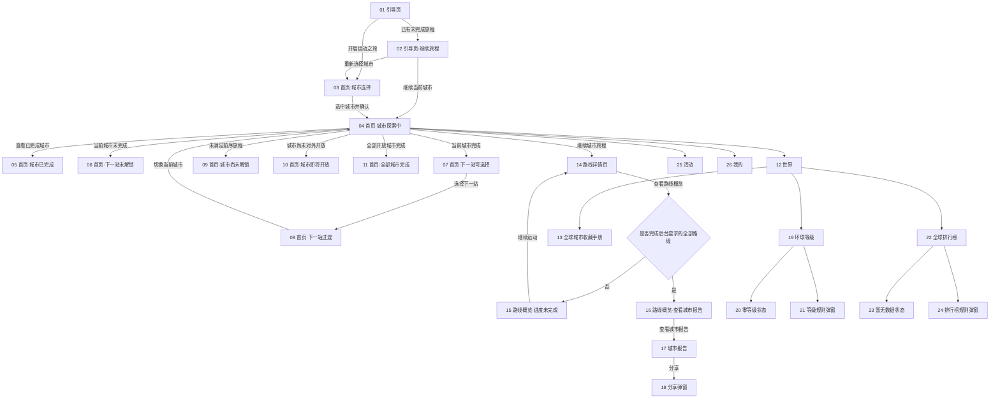
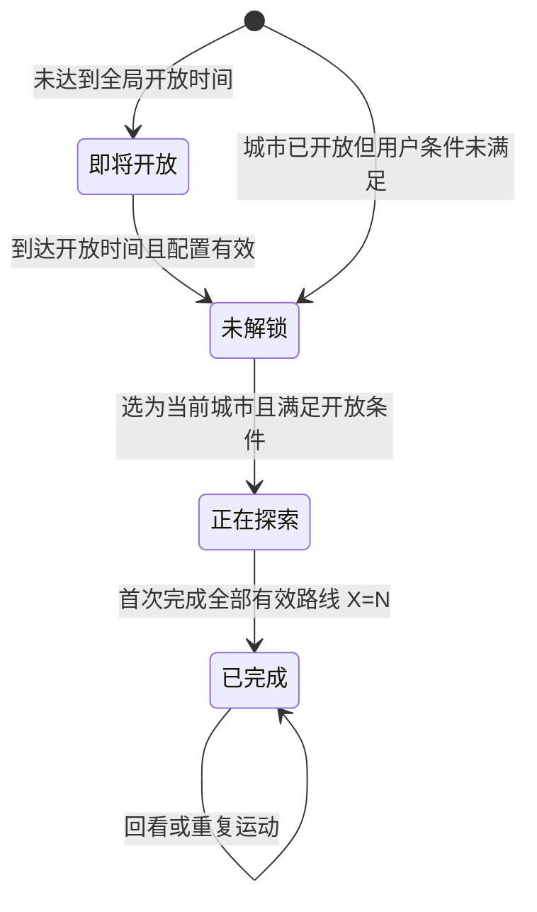

# MOVEVI APP 2.0 页面需求与交互说明

> 文档版本：V.2.0.0
> 阅读对象：产品、设计、研发、测试、运营
> 文档类型：产品需求说明文档
> 编写日期：2026-09-29
> 设计范围：当前版本改动页面

| 版本      | 日期         | 修订内容                      |
| ------- | ---------- | ------------------------- |
| V.2.0.0 | 2026-09-29 | 本次改版涉及页面的需求、交互、状态、数据及验收说明 |

## 阅读对象

| 对象 | 关注内容               |
| -- | ------------------ |
| 产品 | 页面范围、业务规则、状态与待确认项  |
| 设计 | 页面结构、组件状态、文案及边界表现  |
| 研发 | 入口、交互、跳转、数据依赖和异常处理 |
| 测试 | 页面级验收标准、状态组合和异常场景  |
| 运营 | 城市、路线、活动配置口径       |

## 1. 产品概述

### 1.1 背景与目标

MOVEVI 2.0 将室内运动组织成“选择城市—完成路线—完成城市—点亮国家或地区—提升环球等级”的长期旅程。用户无需离开室内，即可通过跑步机或走步机探索全球城市、积累路线进度并查看个人环球成就。

本版本应达到以下可验证目标：

* 新用户可从引导页完成首座城市选择并进入首页。

* 已有未完成旅程的用户可从引导页直接继续当前城市，或重新选择城市。

* 用户可从首页、世界页或全球城市收藏手册进入城市路线。

* 用户能够区分城市的全局“即将开放”状态，以及个人旅程的未解锁、正在探索和已完成状态。

* 用户完成当前城市后台已发布且计入完成条件的全部路线后，可查看城市报告并发起分享。

* 世界页能够呈现国家点亮、环球等级、全球排行榜与累计探索数据。

* LV.0、排行榜暂无数据、全部城市完成等边界状态有独立、可执行的页面表现。

### 1.2 目标用户与权限

| 角色      | 使用场景            | 权限与限制                    |
| ------- | --------------- | ------------------------ |
| 首次使用用户  | 理解产品、选择首座城市     | 可浏览引导和候选城市；选中城市后才能开始旅程   |
| 已开始旅程用户 | 继续当前城市、浏览其他城市   | 可浏览全部城市与路线；仅可开始满足解锁条件的路线 |
| 已完成城市用户 | 查看报告、选择下一站、提升等级 | 可回看已完成路线和报告；重复完成不得重复累计   |
| 未连接设备用户 | 浏览城市、路线和成就      | 可浏览；开始运动时沿用既有设备连接校验      |

### 1.3 名词说明

| 名词      | 定义                                      |
| ------- | --------------------------------------- |
| 城市进度    | 当前城市已完成路线数 / 后台已发布且计入完成条件的路线总数，记为 `X/N` |
| 已完成城市   | 后台当前要求的全部有效路线均已完成的城市，即 `X=N`            |
| 正在探索    | 当前被选择且尚未完成全部有效路线的城市，即 `X<N`             |
| 未解锁     | 城市已全局开放，但用户尚未完成前序旅程或个人解锁条件；仍允许浏览城市路线信息 |
| 即将开放   | 城市已配置但尚未达到全局开放时间；仅展示城市与预计开放时间，不提供路线入口 |
| 点亮国家或地区 | 首次完成其下任一城市后形成的唯一完成记录                    |
| 环球等级    | 已点亮的不同国家和地区数量，范围 LV.0–LV.195            |
| 城市报告    | 城市达到 `N/N` 后生成的汇总与分享内容                  |
| 路线概览    | 汇总城市全部路线及完成状态的长页面，不等同于路线详情页             |

## 2. 全局业务与交互规则

### 2.1 主流程

### 2.2 状态转换

> “即将开放”是城市全局可用性，“未解锁/正在探索/已完成”是用户旅程状态，二者不得混用。候选、推荐、当前批次等属于系统计算状态，不形成额外的用户旅程状态。

### 2.3 核心业务规则

| 编号   | 规则                                                                    |
| ---- | --------------------------------------------------------------------- |
| G-01 | 每座城市的路线数量不固定，由后台上传并发布的有效路线数量决定；城市进度为已完成去重路线数 / 当前计入完成条件的路线总数，即 `X/N`。 |
| G-02 | 首次完成某路线时才增加路线数、景点、里程、时长与消耗；重复完成必须幂等。                                  |
| G-03 | 城市完成条件为后台当前计入完成条件的全部有效路线均已完成；完成后状态不可回退。                               |
| G-04 | 完成城市即点亮其所属国家或地区；同一国家或地区下完成多座城市只记一次。                                   |
| G-05 | 环球等级等于已点亮国家和地区的去重数量，最低 LV.0，最高 LV.195。                                |
| G-06 | 所有已全局开放的城市入口均可进入路线详情；用户未解锁城市只读，不允许绕过解锁规则开始运动。                          |
| G-07 | 路线顺序、开放状态和解锁条件由后台路线配置返回；前端不得按 3、6、10 等固定数量硬编码开放阶段。                    |
| G-08 | 后台新增路线不得导致已完成城市、已点亮国家或环球等级回退；新增路线是否计入既有用户的完成进度由后台路线集合版本决定。            |
| G-09 | 全球排行榜按环球等级从高到低排序；同等级按已完成路线数从高到低排序；仍相同则并列。跑步机榜与走步机榜独立。                 |
| G-10 | 全部已开放城市完成后，首页展示专用缺省卡片，不以任意具体城市充当完成状态。                                 |
| G-11 | 返回操作优先回到真实来源页；来源上下文缺失时，按 Figma 主链路回到首页或世界页。                           |
| G-12 | 尚未达到全局开放时间的城市只展示预计开放信息，不进入路线详情；开放时间到达后再按用户解锁条件计算旅程状态。               |

> 当后台为某城市返回的有效路线总数 `N=0` 时，该城市不得被自动判定为已完成，也不得点亮国家或提升环球等级；页面应显示“路线准备中”，并禁用开始运动与城市报告入口。

### 2.4 全局交互

| 场景      | 执行规则                                            |
| ------- | ----------------------------------------------- |
| 底部导航    | 首页、世界、活动、我的四个一级页固定顺序；当前项高亮；切换时保留用户旅程数据。         |
| 页面返回    | 返回上一业务页面，不清空已选城市、筛选项或路线进度；浏览器返回与页面返回按钮结果一致。     |
| 弹窗/底部面板 | 打开后锁定背景滚动；点击关闭按钮或系统返回关闭；是否允许点遮罩关闭以对应页说明为准。      |
| 主按钮     | 可用态具有明确高亮；请求发出后防重复点击；禁用态降低对比度且不响应点击。            |
| 横向卡片    | 支持触摸滑动、鼠标拖动和键盘方向键；滑动结束后居中最近卡片。                  |
| 长页面     | 15、16 必须纵向滚动；内容不得被底部安全区或浏览器工具栏遮挡。               |
| 数字格式    | 大整数使用本地化千分位；里程、时长、消耗保留设计稿精度；空值显示 `--`，不得伪造 0。   |
| 加载      | 保留页面骨架和关键导航；加载完成后替换内容，不造成明显布局跳动。                |
| 减少动态效果  | 系统开启减少动态效果后，取消翻转、弹性位移和大范围视差，仅保留淡入或即时切换。         |
| 可访问性    | 图标按钮具有可读名称；Tab 顺序与视觉顺序一致；弹窗打开后焦点进入弹窗，关闭后返回触发按钮。 |

### 2.5 全局异常处理

| 场景        | 处理                         | 建议文案       |
| --------- | -------------------------- | ---------- |
| 网络不可用     | 保留可用缓存；涉及新数据的区域显示重试入口      | 网络连接异常，请重试 |
| 请求超时      | 停止加载状态，允许重试，不清空已有数据        | 加载超时，请稍后重试 |
| 城市或路线不存在  | 返回来源页并提示，禁止进入空白页           | 该内容暂时不可用   |
| 图片/视频失败   | 使用城市渐变或默认封面；不阻断核心按钮        | 无需额外弹窗     |
| 重复点击      | 首次触发后临时禁用控件                | 无需重复提示     |
| 数据不完整     | 对单字段显示 `--`；核心对象缺失时显示页面级错误 | 数据暂未同步完成   |
| 未解锁路线尝试开始 | 保持当前页，说明解锁条件               | 完成前序路线后解锁  |

## 3. 页面导航矩阵

| 序号 | 页面             | Figma Frame                                                                       | 主要入口                   | 主要去向                    |
| -- | -------------- | --------------------------------------------------------------------------------- | ---------------------- | ----------------------- |
| 01 | 引导页            | [74:89](https://www.figma.com/design/EcUBAfAwvLC0H6Tg8tqZ9R/?node-id=74-89)       | 首次进入或无可继续旅程            | 03                      |
| 02 | 引导页｜继续旅程       | [351:2](https://www.figma.com/design/EcUBAfAwvLC0H6Tg8tqZ9R/?node-id=351-2)       | 已存在未完成的当前城市            | 03、04                   |
| 03 | 首页｜城市选择        | [74:324](https://www.figma.com/design/EcUBAfAwvLC0H6Tg8tqZ9R/?node-id=74-324)     | 01 CTA、02 重新选择        | 04                      |
| 04 | 首页｜城市探索中       | [78:2](https://www.figma.com/design/EcUBAfAwvLC0H6Tg8tqZ9R/?node-id=78-2)         | 02 继续、03 确认、底部首页     | 05–14、25、26             |
| 05 | 首页｜城市已完成       | [202:2](https://www.figma.com/design/EcUBAfAwvLC0H6Tg8tqZ9R/?node-id=202-2)       | 首页轮播定位到已完成城市          | 12、14、25、26             |
| 06 | 首页｜下一站未解锁      | [218:2](https://www.figma.com/design/EcUBAfAwvLC0H6Tg8tqZ9R/?node-id=218-2)       | 当前城市未完成时定位下一站卡        | 12、14、25、26             |
| 07 | 首页｜下一站可选择      | [218:1375](https://www.figma.com/design/EcUBAfAwvLC0H6Tg8tqZ9R/?node-id=218-1375) | 当前城市完成后定位下一站卡         | 08、12、14、25、26          |
| 08 | 首页｜下一站过渡       | [224:2](https://www.figma.com/design/EcUBAfAwvLC0H6Tg8tqZ9R/?node-id=224-2)       | 07 选择候选城市            | 04                      |
| 09 | 首页｜城市尚未解锁      | [364:2](https://www.figma.com/design/EcUBAfAwvLC0H6Tg8tqZ9R/?node-id=364-2)       | 首页轮播定位到未满足前序条件的城市    | 12、14、25、26             |
| 10 | 首页｜城市即将开放      | [218:2759](https://www.figma.com/design/EcUBAfAwvLC0H6Tg8tqZ9R/?node-id=218-2759) | 首页轮播定位到尚未对外开放城市      | 12、25、26                |
| 11 | 首页｜全部城市完成      | [127:2](https://www.figma.com/design/EcUBAfAwvLC0H6Tg8tqZ9R/?node-id=127-2)       | 所有已开放城市完成            | 12、25、26                |
| 12 | 世界             | [74:789](https://www.figma.com/design/EcUBAfAwvLC0H6Tg8tqZ9R/?node-id=74-789)     | 底部世界                 | 04、13、14、19、22、25、26    |
| 13 | 全球城市收藏手册       | [78:1375](https://www.figma.com/design/EcUBAfAwvLC0H6Tg8tqZ9R/?node-id=78-1375)   | 12 收藏手册按钮            | 12、14                   |
| 14 | 路线详情           | [74:1132](https://www.figma.com/design/EcUBAfAwvLC0H6Tg8tqZ9R/?node-id=74-1132)   | 城市入口                 | 来源页、15、16、既有运动流程       |
| 15 | 路线概览｜进度未完成     | [157:2](https://www.figma.com/design/EcUBAfAwvLC0H6Tg8tqZ9R/?node-id=157-2)       | 14，`X<N`             | 14                      |
| 16 | 路线概览｜查看城市报告    | [89:2](https://www.figma.com/design/EcUBAfAwvLC0H6Tg8tqZ9R/?node-id=89-2)         | 14，`X=N`             | 14、17                   |
| 17 | 城市报告｜完成态       | [86:2](https://www.figma.com/design/EcUBAfAwvLC0H6Tg8tqZ9R/?node-id=86-2)         | 16 CTA                | 16、18                   |
| 18 | 城市报告｜分享弹窗      | [171:2](https://www.figma.com/design/EcUBAfAwvLC0H6Tg8tqZ9R/?node-id=171-2)       | 17 分享                | 17、系统分享/保存              |
| 19 | 环球等级           | [74:1535](https://www.figma.com/design/EcUBAfAwvLC0H6Tg8tqZ9R/?node-id=74-1535)   | 12、26                | 12、21                   |
| 20 | 环球等级｜零等级       | [127:1516](https://www.figma.com/design/EcUBAfAwvLC0H6Tg8tqZ9R/?node-id=127-1516) | 等级为 0 时进入等级页         | 12、21                   |
| 21 | 环球等级｜规则弹窗      | [81:2](https://www.figma.com/design/EcUBAfAwvLC0H6Tg8tqZ9R/?node-id=81-2)         | 19/20 规则按钮           | 19/20                   |
| 22 | 全球排行榜          | [74:1699](https://www.figma.com/design/EcUBAfAwvLC0H6Tg8tqZ9R/?node-id=74-1699)   | 12 排行榜               | 12、24                   |
| 23 | 全球排行榜｜暂无数据     | [127:1375](https://www.figma.com/design/EcUBAfAwvLC0H6Tg8tqZ9R/?node-id=127-1375) | 当前设备榜无数据             | 12、24                   |
| 24 | 全球排行榜｜规则弹窗     | [147:2](https://www.figma.com/design/EcUBAfAwvLC0H6Tg8tqZ9R/?node-id=147-2)       | 22/23 规则按钮           | 22/23                   |
| 25 | 活动             | [74:2072](https://www.figma.com/design/EcUBAfAwvLC0H6Tg8tqZ9R/?node-id=74-2072)   | 底部活动                 | 04、12、26、既有活动详情         |
| 26 | 我的             | [74:2209](https://www.figma.com/design/EcUBAfAwvLC0H6Tg8tqZ9R/?node-id=74-2209)   | 底部我的                 | 04、12、19、25、既有二级功能      |

## 4. 逐页需求与交互说明

> **多状态页面编写约定**：同一功能存在多个 Figma 状态 Frame 时，第一个状态页定义公共页面结构、通用交互、数据口径和异常规则；后续状态页仅描述相对公共基线发生变化的触发条件、展示内容、交互、异常与验收要求。未明确列出的内容均继承公共基线和第 2 章全局规则，不再重复说明。

### 4.1 01｜引导页

**页面目标与用户故事**

作为首次使用用户，我希望快速理解 MOVEVI 是“让你足不出户，跑遍全球”的室内运动产品，并开始选择第一座城市。

**入口与退出**

* 入口：用户尚未完成首次城市选择时进入产品。

* 前置条件：城市基础数据可用；图片失败不阻断页面。

* 后置条件：无可继续旅程时，点击 CTA 只进入 03，不创建旅程；存在未完成当前城市时按 02 展示继续旅程状态。

* 退出：无显式返回；系统返回按容器默认行为处理。

**界面与交互**

| 元素     | 展示与数据                    | 交互             |
| ------ | ------------------------ | -------------- |
| 品牌区    | MOVEVI 标识                | 仅展示            |
| 城市叠卡视觉 | 东京、巴黎、纽约等视觉卡片，以 Figma 为准 | 仅展示；允许轻微入场动效   |
| 辅助标题   | “你的环球运动旅程”               | 仅展示            |
| 主标题    | “让你足不出户 / 跑遍全球”，不带标点     | 仅展示            |
| 能力标签   | 城市路线、沿途景点、运动记录           | 仅展示            |
| 主 CTA  | “开启运动之旅”                 | 点击进入 03；单次点击防抖 |

**状态与异常**

* 小屏内容允许纵向滚动，CTA 不得遮挡正文。

* 城市图片失败时显示渐变占位，文案与 CTA 保持可用。

* 已完成首次选择且存在未完成当前城市的用户再次进入时展示 02；当前城市上下文无效时进入 03。

**验收标准**

1. 主标题无逗号、句号和感叹号。
2. 首次使用用户点击 CTA 进入 03；已有未完成旅程的用户进入 02，且不会产生重复导航。
3. 360px 宽度下内容无横向溢出，CTA 可见或可通过滚动到达。

### 4.2 02｜引导页｜继续旅程

**状态触发**

* 用户已完成首次选城，存在有效当前城市，且该城市进度为 `X<N`。

* 本页沿用 01 的品牌与视觉基线，仅替换为继续旅程内容；不在进入页面时修改城市或进度。

**相对 01 的差异**

| 差异项 | 本状态要求 | 交互差异 |
| --- | --- | --- |
| 引导文案 | “你有一座城市正在探索”“已为你选中上次的运动城市，可以从当前进度继续。” | 仅展示 |
| 当前城市卡 | 显示“正在探索”、城市中英文名、国家或地区及实际 `X/N`；Figma 中“日本 · TOKYO”“9/10 路线”为示例 | 卡片保持选中态，不重复创建旅程 |
| 主 CTA | “继续当前城市” | 携带当前 `cityId` 进入 04 |
| 次操作 | “重新选择城市” | 进入 03；在新城市确认前不覆盖当前城市与既有进度 |

**差异异常与验收**

* 当前城市失效、已下架或进度上下文缺失时不展示本状态，回退到 03。

* 当前城市已达到 `N/N` 时不展示“继续旅程”，应根据旅程状态进入首页已完成或下一站流程。

* 主 CTA 只能进入卡片所示城市；重新选择后取消操作或返回时，原城市和进度保持不变。

### 4.3 03｜首页｜城市选择

**页面目标与用户故事**

作为首次使用用户，我希望从推荐城市中选出第一站，以便建立初始旅程。

**入口与退出**

* 入口：01 点击“开启运动之旅”，或 02 点击“重新选择城市”。

* 前置条件：存在至少一个可选城市。

* 后置条件：确认后写入当前城市、读取该城市后台路线总数并初始化为 `0/N`，随后进入 04。

* 返回：从 01 进入时返回 01；从 02 进入时返回 02；均不保留未确认选择，已确认后不得通过返回撤销已建立旅程。

**界面与交互**

| 元素     | 展示与数据                        | 交互                       |
| ------ | ---------------------------- | ------------------------ |
| 页面标题   | 按 Figma 展示选择下一座城市的标题与说明      | 仅展示                      |
| 推荐城市卡  | 每批最多 3 座；显示序号、城市中文名、英文名和城市图片 | 点击后选中；同批只能单选             |
| 换一批    | 候选超过当前批时展示                   | 点击切换下一批；循环后回到首批；不得出现同批重复 |
| 确认 CTA | 未选择时禁用；选中后显示对应城市出发文案         | 点击后再次校验城市有效性，成功进入 04     |

**状态与异常**

* 候选不足 3 座时按实际数量展示，并隐藏无意义的“换一批”。

* 候选为空时展示“暂时无法加载城市”和重试入口，CTA 禁用。

* 换批后若原选择不在新批次中，清除选择并恢复 CTA 禁用态。

* 图片失败使用城市默认封面，不影响选择。

**验收标准**

1. 未选城市不能提交；选中后有明确选中态和可用 CTA。
2. 快速连续点击“换一批”不会越界或生成重复卡片。
3. 提交成功后首页当前城市与用户所选城市一致。

### 4.4 04｜首页｜城市探索中

> 本节同时作为 04–11 首页状态的公共基线；4.5–4.11 仅记录相对本节的差异。

**页面目标与用户故事**

作为旅程中的用户，我希望查看当前城市进度、切换城市卡片并继续下一条路线。

**入口与退出**

* 入口：02 继续当前城市、03 首次城市确认、底部“首页”或从路线页返回。

* 前置条件：存在当前城市。

* 后置条件：浏览行为不改变进度；进入路线时携带 `cityId` 与来源页。

* 退出：底部导航进入 12、25、26；城市 CTA 进入 14；轮播可进入 05–11 对应首页状态。

**界面与交互**

| 元素     | 展示与数据                                         | 交互                                     |
| ------ | --------------------------------------------- | -------------------------------------- |
| 顶部工具   | 在线客服、设备状态、打卡红包                                | 沿用现有功能；失败不得影响城市卡片                      |
| 标题     | “今天跑哪里？”                                      | 仅展示                                    |
| 目的地分类  | “当前目的地”“全球目的地”；显示范围以 Figma 为准                  | 切换后定位对应城市卡组，不改变当前城市                    |
| 城市轮播   | 已完成城市、当前城市和未解锁城市；显示国家、英文名、跑过人数、`X/N`、里程、时长、消耗 | N 取该城市后台有效路线总数；横向滑动/拖动/方向键切换，停下后居中最近卡片 |
| 当前城市卡  | 状态“当前目的地”；Figma 中的 9/10 仅为示例                  | CTA“继续{城市}旅程”，进入 14                    |
| 跑过人数   | “{本地化人数} 人跑过”，位于城市名称信息右侧                      | 只要用户在当前城市任一路线运动过（无论有没有完成），就计入跑过人数。     |
| 已完成城市卡 | 状态“已完成城市”，进度为 `N/N`；对应 05                     | CTA“查看{城市}旅程”，进入 14                    |
| 尚未解锁城市卡 | 状态“全球目的地”；对应 09；城市已开放但用户未完成前序条件             | 卡片主体可进入 14 的只读状态；禁用 CTA 不可开始运动         |
| 即将开放城市卡 | 状态“尚未开放”；对应 10；城市尚未对外开放                     | 仅展示城市与预计开放时间，不进入路线页                    |
| 下一站卡   | 当前城市未完成显示 06；完成后显示 07；选择后进入 08                | 根据当前城市完成状态切换，不与普通城市卡混用                 |
| 底部导航   | 首页高亮                                          | 世界→12，活动→25，我的→26                      |

**状态与异常**

* 视频自动播放失败时保留封面并提供可点击播放入口；视频加载失败回退图片。

* 拖动距离超过点击阈值时只切卡，不触发卡片 CTA。

* 当前城市进度到达 `N/N` 后，首页应刷新完成状态或进入下一站推荐，不再显示未完成进度。

**验收标准**

1. 各状态城市均可进入对应路线页，未解锁城市不能开始运动。
2. 轮播居中、缩放和点击区域一致，不发生误触。
3. 底部导航与城市卡片之间保留 Figma 规定的安全间距，不重叠。

### 4.5 05｜首页｜城市已完成

**状态触发**

* 首页轮播定位到已完成后台当前要求全部路线的城市，即 `X=N`。

* 浏览和回看不得重复增加路线、城市、国家或等级。

**相对 04 的差异**

| 差异项   | 本状态要求        | 交互差异                 |
| ----- | ------------ | -------------------- |
| 城市状态  | 显示“已完成城市”    | 状态来自统一城市进度计算         |
| 完成进度  | `N/N` 与满格进度条 | N 取后台有效路线总数，不固定为 10  |
| 主 CTA | “查看{城市}旅程”   | 进入 14，携带该城市 `cityId` |

**差异异常与验收**

* 若完成标记与路线进度不一致，重新进入首页后按统一进度口径校验并切换为 04，同时记录数据异常。

* 完成状态、`N/N`、满格进度条和 CTA 城市名必须一致；重复点击 CTA 只导航一次。

### 4.6 06｜首页｜下一站未解锁

**状态触发**

* 首页轮播至“下一站”卡，且存在尚未完成全部必需路线的当前城市，即 `X<N`。

* 本状态不创建候选城市，也不切换当前城市。

**相对 04 的差异**

| 差异项  | 本状态要求                        | 交互差异               |
| ---- | ---------------------------- | ------------------ |
| 标题区  | 标签“下一站”；标题“完成当前城市后开启”        | 仅展示                |
| 解锁说明 | “完成{当前城市}全部 N 段路线，即可解锁下一站选择” | N 动态取后台必需路线总数      |
| 候选预览 | 最多 3 张灰化候选缩略卡                | 只作预告，不响应选择         |
| 底部按钮 | 锁定态“继续完成当前旅程”                | 不作为候选确认；引导用户滑回当前城市 |

**差异异常与验收**

* 候选不足 3 座时按实际数量展示；`N=0` 时显示“路线准备中”，不展示可解锁承诺。

* 预览卡和按钮均不可选择；城市名和 N 值取当前城市数据；达到 `N/N` 后切换为 07。

### 4.7 07｜首页｜下一站可选择

**状态触发**

* 首页轮播至“下一站”卡，当前城市已完成且存在可选候选城市。

* 候选池排除当前城市、已完成城市和无效城市。

**相对 04 的差异**

| 差异项 | 本状态要求                    | 交互差异                         |
| --- | ------------------------ | ---------------------------- |
| 标题区 | 标签“下一站”；标题“选择下一座城市”      | 仅展示                          |
| 换一批 | 候选多于当前批次时展示              | 切换下一批，单批最多 3 座且不重复           |
| 说明  | “从 K 个推荐目的地中选择你的环球旅程下一站” | K 按当前实际候选数更新                 |
| 推荐卡 | 序号、城市图片、中文名和英文名          | 点击后暂存目标城市并进入 08；过渡完成前不覆盖当前城市 |

**差异异常与验收**

* 候选池为空且所有开放城市已完成时进入 10；其他空结果显示加载失败或等待开放状态。

* 推荐数量与 K 一致；换批不产生重复或无效城市；连续点击只接受首次有效选择。

* 进入 08 时必须携带来源城市和目标城市。

### 4.8 08｜首页｜下一站过渡

**状态触发**

* 07 点击有效推荐城市后进入；来源城市与目标城市均须有效。

* 该 Frame 是首页旅程切换的全屏过渡态，不继承首页底部导航和城市轮播。

**相对 04 的差异**

| 差异项  | 本状态要求                                              | 交互差异                     |
| ---- | -------------------------------------------------- | ------------------------ |
| 文案   | “NEXT DESTINATION”“下一站，{目标城市}”“{来源城市} → {目标城市英文名}” | 全部与实际切换数据一致              |
| 轨迹动画 | 起点、虚线路径、方向箭头与目标点                                   | 动画结束后将目标城市设为当前城市并自动进入 04 |
| 常驻控件 | 不展示底部导航和额外操作按钮                                     | 系统返回取消未完成切换并回到 07        |

**差异异常与验收**

* 减少动态效果开启时跳过路径动画；目标城市失效时取消切换并回到 07。

* 页面恢复或重复回调不得二次提交；一次过渡只能产生一次城市切换。

### 4.9 09｜首页｜城市尚未解锁

**状态触发**

* 首页轮播定位到已在城市目录开放、但用户尚未完成前序旅程或其他个人解锁条件的城市。

* 本状态只表示“对该用户尚未解锁”，不等同于城市尚未对外开放；浏览不改变当前城市或解锁状态。

**相对 04 的差异**

| 差异项 | 本状态要求 | 交互差异 |
| --- | --- | --- |
| 状态与进度 | 标签“全球目的地”；显示实际 `0/N` 与空进度条 | N 取后台当前有效路线总数 |
| 解锁提示 | “完成前序旅程后逐步开放” | 仅展示；具体前序条件由后台配置 |
| 禁用 CTA | “{城市} · 尚未开放”及锁图标 | 不可开始运动；卡片主体仍可进入 14 浏览只读路线 |

**差异异常与验收**

* 满足解锁条件后刷新为可探索状态；`N=0` 时显示“路线准备中”，不显示 `0/0`。

* 禁用 CTA 不可执行或获得可执行焦点；卡片主体仍须可进入 14，并具有“查看城市路线”的可访问名称。

* 本状态不得展示“预计开放日期”；若城市本身尚未对外开放，应使用 10。

### 4.10 10｜首页｜城市即将开放

**状态触发**

* 首页轮播定位到已配置但尚未达到全局开放时间的城市。

* 浏览不改变当前城市或解锁状态。

**相对 04 的差异**

| 差异项    | 本状态要求                 | 交互差异                      |
| ------ | --------------------- | ------------------------- |
| 城市视觉 | 城市图片、中文名、英文名及状态“尚未开放” | 仅展示，不提供路线进度与运动入口 |
| 开放提示 | “预计 {开放日期} 开放” | 开放日期取后台城市配置；Figma 中“2026年12月”为示例，不得硬编码 |
| 页面行为 | 不展示可执行 CTA | 卡片不可进入路线详情，不可开始运动 |

**差异异常与验收**

* 城市到达开放时间且配置有效后，按用户条件切换为可探索状态或 09；加载中不得短暂展示错误开放日期。

* 状态标签、城市名和开放日期必须来自同一城市配置；整张卡不得出现进度条、里程、时长、消耗或路线 CTA。

### 4.11 11｜首页｜全部城市完成

**状态触发**

* 开放城市集合非空且全部完成时进入，或首页轮播至最终缺省卡。

* 本状态不创建新城市、不改变当前城市，只能通过公共底部导航离开。

**相对 04 的差异**

| 差异项   | 本状态要求                  | 交互差异           |
| ----- | ---------------------- | -------------- |
| 终局缺省卡 | 不显示任何具体城市图片；使用通用环球完成视觉 | 仅展示            |
| 状态文案  | “JOURNEY COMPLETE”“当前完成全部城市”“所有已开放城市路线均已完成”；卡片内展示“当前开放的城市已全部跑完 / 更多城市正在准备中” | 仅展示 |
| 底部按钮  | 保留按钮形态但使用禁用色           | 不可点击、不可获得可执行焦点 |

**差异异常与验收**

* 新增开放城市后恢复普通轮播和下一站选择；数据加载中不得短暂闪现本状态。

* 缺省卡不得出现具体城市名、图片、里程等城市内容；禁用按钮点击无跳转。

### 4.12 12｜世界

**页面目标与用户故事**

作为长期运动用户，我希望通过地球看到已点亮国家、城市标记、等级、排名及累计探索成果。

**入口与退出**

* 入口：底部“世界”。

* 前置条件：城市坐标、国家/地区编码和用户进度可用。

* 后置条件：旋转和浏览不修改业务数据。

* 退出：首页→04–11，活动→25，我的→26；功能入口进入 13、14、19、22。

**界面与交互**

| 元素        | 展示与数据                                         | 交互                                |
| --------- | --------------------------------------------- | --------------------------------- |
| 顶部小标题     | “跑步版 Google Earth”                            | 仅展示                               |
| 3D 地球     | 已完成国家/地区高亮；当前城市突出；未解锁城市灰色；中国区域包含台湾图形          | 支持旋转和缩放；城市标记均可点击进入 14             |
| 环球等级浮动按钮  | 左侧，`LV.X / 195`                               | 点击进入 19 或 20                      |
| 全球排行榜浮动按钮 | 右侧，展示我的排名                                     | 点击进入 22 或 23                      |
| 探索进度      | 城市探索、路线完成、累计里程、运动时长和累计消耗；Figma 中 `4/20`、`49/300` 等均为示例 | 分子来自用户去重进度，分母来自后台当前有效城市/路线配置；空值按 0 或 `--` 规则展示 |
| 收藏手册按钮    | “全球城市收藏手册”                                    | 点击打开 13                           |
| 底部导航      | 世界高亮                                          | 切换一级页                             |

**状态与异常**

* WebGL 不可用时展示静态世界地图或占位图，保留所有功能入口。

* 国家编码无法映射时不点亮、不增加等级，但保留城市完成记录并上报异常。

* 同一国家多城完成只高亮一次；达到 LV.195 后等级封顶。

* 地球操作与页面纵向滚动需区分手势，避免拖地球时误滚页面。

**验收标准**

1. 已完成国家高亮与去重等级结果一致。
2. 灰色城市标记可进入路线详情，但未解锁路线不可开始。
3. 等级在左、排行榜在右，均为独立可点击浮动入口。

### 4.13 13｜全球城市收藏手册

**页面目标与用户故事**

作为用户，我希望按大洲浏览全部城市，并从任意城市卡片进入路线详情。

**入口与退出**

* 入口：12 的收藏手册按钮。

* 前置条件：城市目录可用。

* 后置条件：筛选不改变城市状态；选中城市后携带 `cityId` 进入 14。

* 退出：关闭按钮或系统返回回到 12；若以弹层实现，关闭后恢复世界页滚动位置。

**界面与交互**

| 元素    | 展示与数据                | 交互            |
| ----- | -------------------- | ------------- |
| 标题与关闭 | “全球城市收藏手册”           | 关闭返回 12       |
| 大洲筛选  | 全部及各大洲，单选            | 点击即时筛选；当前项高亮  |
| 城市卡   | 序号、图片、中文名、英文名、进度条和状态；Figma 当前展示 20 张为示例配置 | 所有已开放状态均可点击进入 14；全局未开放城市只展示开放信息 |
| 已完成   | 完成印章、`N/N`           | 可查看路线         |
| 正在探索  | 当前状态标签和实际进度          | 可继续路线         |
| 未解锁   | 灰化和锁图标               | 可浏览只读路线，不可开始  |

**状态与异常**

* 筛选结果为空时展示“该区域暂无城市”，保留筛选导航。

* 城市目录失败时显示重试，不关闭手册。

* 状态必须来自统一进度计算，不能由卡片本地单独维护。

**验收标准**

1. 用户旅程三态与全局“即将开放”状态的视觉、文案和可点击范围有明确区分。
2. 筛选后序号保持全局城市序号，不因筛选重新编号。
3. 用户尚未解锁的城市卡可进入 14 且无法绕过路线锁定；全局尚未开放城市不可进入路线页。

### 4.14 14｜路线详情

**页面目标与用户故事**

作为进入某座城市的用户，我希望查看后台为该城市发布的全部路线、状态和跑者信息，并选择可运行路线或查看路线概览。

**入口与退出**

* 入口：04–11 首页城市卡、12 地球标记、13 收藏手册城市卡。

* 前置条件：有效 `cityId`；来源页写入 `returnTo`。

* 后置条件：浏览不改变进度；开始运动后进入既有运动执行流程。

* 返回：优先回 `returnTo`；缺失时按 Figma 主链路回到 04。

**界面与交互**

| 元素     | 展示与数据                                 | 交互                         |
| ------ | ------------------------------------- | -------------------------- |
| 城市信息   | 城市图片、中文/英文名、国家或地区、总体进度                | 仅展示                        |
| 路线分类   | 按设计稿展示分类标签                            | 点击切换列表；保留城市上下文             |
| 路线列表   | 数量和顺序取后台有效路线配置；显示序号、路线名、景点、距离、跑过人数和状态 | 已解锁路线可进入详情/开始；已完成可回看；未解锁只读 |
| 路线概览入口 | 页面头部或指定按钮                             | `X<N` 进入 15；`X=N` 进入 16    |
| 开始运动   | 沿用既有按钮和设备校验                           | 未连接时进入既有连接引导；不在本文扩展        |

**状态与异常**

* `cityId` 无效时返回来源页并提示内容不可用。

* 后台返回 0 条有效路线时展示“路线准备中”，不展示空的完成进度，不允许开始运动或打开城市报告。

* 跑过人数缺失显示“暂无跑者记录”，负数按数据异常处理。

* 路线状态在页面打开期间发生变化时，返回页面后重新拉取，不使用过期锁定态。

**验收标准**

1. 页面路线数量、完成数和城市进度分母均与后台有效路线配置一致。
2. 路线概览能根据进度正确进入 15 或 16。
3. 未解锁路线没有可执行的开始入口。

### 4.15 15｜路线概览｜进度未完成

> 本节同时作为 15、16 路线概览页的公共基线；4.16 仅记录完成态差异。

**页面目标与用户故事**

作为尚未完成城市的用户，我希望在一个长页面中查看全部路线状态和下一段路线，以便继续运动。

**入口与退出**

* 入口：14 点击路线概览，且已完成路线数小于后台当前要求的路线总数，即 `X<N`。

* 前置条件：有效 `cityId` 和路线进度；实际状态为 `X<N`，Figma 中的 9/10 仅为示例。

* 后置条件：仅浏览，不自动完成路线。

* 返回：顶部返回或底部 CTA 均回到 14，并保留当前城市。

**界面与交互**

| 元素    | 展示与数据                        | 交互                                |
| ----- | ---------------------------- | --------------------------------- |
| 顶部区域  | `{城市} · {N} 段`、城市概览、累计运动指标和实际 `X/N` | N 取后台有效路线总数；返回 14；Figma 中“北京 · 10 段”为示例 |
| 路线图例  | 已完成、下一段、未解锁等状态               | 只读                                |
| 路线记录  | 按后台顺序展示全部有效路线、景点、距离和状态；下一条突出 | 已完成可查看；下一段可返回 14 选择；未解锁无开始行为      |
| 主 CTA | “了解完成，继续运动”                  | 返回 14，定位到下一条可运行路线                 |

**状态与异常**

* 页面为 390×1424 设计基准的长页面，必须自然滚动，不缩放整页适配视口。

* 数据更新后若已达到 `N/N`，应切换为 16，不继续停留在未完成态。

* 底部 CTA 不得遮挡最后一条路线；需预留安全区。

**验收标准**

1. 长页面可从顶部滚动至 CTA，内容无裁切和重叠。
2. 完成数、路线状态和下一段指示一致。
3. CTA 返回 14 后定位到正确的下一条路线。

### 4.16 16｜路线概览｜查看城市报告

**状态触发**

* 从 14 进入时，已完成路线数等于后台当前要求的路线总数，即 `X=N`。

**相对 15 的差异**

| 差异项   | 本状态要求             | 交互差异                               |
| ----- | ----------------- | ---------------------------------- |
| 完成概览  | `N/N`，所有必需路线均为已完成 | 路线仍可回看，但不改变完成状态                    |
| 主 CTA | “查看城市报告”          | 进入 17，携带 `cityId` 与报告数据；不重复结算奖励或等级 |

**差异异常与验收**

* 任一必需路线未完成时回退为 15；报告未生成时 CTA 显示加载/重试状态。

* 仅 `X=N` 时展示报告 CTA；页面仍按公共长页面规则滚动，且重复进入不会增加业务数据。

### 4.17 17｜城市报告｜完成态

**页面目标与用户故事**

作为完成城市的用户，我希望查看本次城市旅程总结，并可生成分享内容。

**入口与退出**

* 入口：16 点击“查看城市报告”。

* 前置条件：城市为 `N/N`，报告数据可计算。

* 后置条件：浏览报告不改变运动数据；分享仅生成或传递海报。

* 返回：回到 16；分享进入 18。

**界面与交互**

| 元素     | 展示与数据                        | 交互              |
| ------ | ---------------------------- | --------------- |
| 报告标题   | “我跑遍了{城市}”                   | 城市名动态替换         |
| 完成度    | 100% 与完整进度条                  | 仅展示             |
| 核心指标   | 路线数、景点数、公里数、运动时长             | 来自该城市去重汇总       |
| 旅程亮点   | 最长路线、途经景点、累计消耗、累计运动等 Figma 项 | 仅展示；缺失显示 `--`   |
| 分享 CTA | 以 Figma 文案为准                 | 打开 18；生成期间防重复点击 |

**状态与异常**

* 报告生成失败时保留页面结构，显示重试，不降级成未完成状态。

* 统计值必须来自该城市，不得混入用户全局累计值。

* 返回后再进入应复用同一完成记录，不重复生成业务结果。

**验收标准**

1. 页面城市名、背景和统计均对应当前 `cityId`。
2. 路线数显示该城市实际完成的有效路线数量，完成度为 100%。
3. 分享按钮只打开 18，不添加设计稿外的中间页面。

### 4.18 18｜城市报告｜分享弹窗

**状态触发**

* 17 点击分享且报告数据可用时，在报告页上方打开底部弹窗。

* 成功分享、保存或关闭后仍保留 17 的报告上下文和滚动位置。

**相对 17 的差异**

| 差异项    | 本状态要求                                       | 交互差异                    |
| ------ | ------------------------------------------- | ----------------------- |
| 底部面板标题 | “分享城市报告”与关闭按钮                               | 关闭回 17                  |
| 海报预览   | 用户头像、昵称、时间、城市图、标题、100% 完成度、4 项指标、4 项亮点与品牌页脚 | 仅预览；内容严格按 Figma，不增加说明   |
| 微信好友   | Figma 指定按钮                                  | 调用可用分享能力；失败时保留面板并给出操作反馈 |
| 朋友圈    | Figma 指定按钮                                  | 调用可用分享能力或沿用现有降级方案       |
| 保存图片   | Figma 指定按钮                                  | 生成并保存图片；请求期间防重复点击       |

**差异异常与验收**

* 弹窗打开后背景模糊并锁定滚动；焦点位于关闭按钮或首个操作。

* 海报生成失败时不关闭弹窗，显示失败反馈并允许重试。

* 不新增隐私提示、奖励、分享说明、额外按钮或设计稿外文案。

* 海报数据须正确；三个操作均有结果反馈；关闭按钮、系统返回或允许的遮罩点击均恢复 17 原滚动位置和背景滚动。

### 4.19 19｜环球等级

> 本节同时作为 19、20 环球等级页的公共基线；4.20 仅记录零等级差异。21 为独立规则弹窗。

**页面目标与用户故事**

作为已完成至少一个国家或地区的用户，我希望查看环球等级、下一等级进度和完成记录。

**入口与退出**

* 入口：12 左侧环球等级按钮，或 26 的等级入口。

* 前置条件：去重国家完成记录数量大于 0。

* 后置条件：仅浏览，不修改等级。

* 返回：回 12；规则按钮打开 21。

**界面与交互**

| 元素    | 展示与数据                      | 交互                    |
| ----- | -------------------------- | --------------------- |
| 顶部导航  | 返回、标题“环球等级”、规则             | 返回 12；规则打开 21         |
| 等级主视觉 | “你已点亮世界的 X 个国家和地区”、LV.X    | X 为去重数量，与等级一致         |
| 进度卡   | 当前等级、距下一级还差 1 个国家或地区、X/195 | 不显示已要求移除的“X 当前等级”冗余文案 |
| 完成记录  | 按国家或地区聚合；显示完成城市、路线数和状态     | 同一国家多城市合并为一条国家记录      |

**状态与异常**

* X 达到 195 时显示满级状态，不再展示“距下一级”。

* 国家记录与等级不一致时，以去重记录重算并记录异常。

* 城市名称缺失时保留国家记录，城市列表显示 `--`。

**验收标准**

1. 等级、X/195、国家记录条数三者一致。
2. 北京与上海等同一国家城市只贡献一级，并在同一条记录中展示。
3. 返回和规则按钮均可用，内容无标题冗余。

### 4.20 20｜环球等级｜零等级

**状态触发**

* 从 12 或 26 进入环球等级时，去重国家或地区完成记录为空，环球等级为 0。

**相对 19 的差异**

| 差异项   | 本状态要求                         | 交互差异    |
| ----- | ----------------------------- | ------- |
| 等级与进度 | `LV.0`、`0/195`                | 仅展示     |
| 完成记录  | 使用 Figma 指定空态，并说明完成城市后点亮国家或地区 | 不伪造示例记录 |

**差异异常与验收**

* 数据加载中不得先闪现 LV.0；仅确认空集合后展示。

* 等级、进度和记录均须为 0；完成首个国家或地区后切换为 19，不再进入本状态。

### 4.21 21｜环球等级｜规则弹窗

**状态触发**

* 点击 19 或 20 的“规则”后，在原等级页上打开弹窗；不得改变等级或页面数据。

**相对 19/20 的差异**

弹窗必须完整展示以下三条规则：

1. 完成一座城市的全部路线，即点亮其所属国家或地区，环球等级 +1。
2. 同一国家或地区的多个完成城市只计算一次，例如北京和上海共同计为中国。
3. 环球等级上限为 LV.195。

**差异交互与验收**

* 弹窗打开后锁定背景；关闭后焦点返回“规则”按钮。

* 不增加等级权益、奖励、任务或其他设计稿外规则。

* 关闭按钮、系统返回或遮罩均回到触发弹窗的 19/20 原状态；三条规则文本和顺序与 Figma 一致。

### 4.22 22｜全球排行榜

> 本节同时作为 22、23 全球排行榜页的公共基线；4.23 仅记录空榜差异。24 为独立规则弹窗。

**页面目标与用户故事**

作为用户，我希望按设备类型查看基于环球等级的全球排名，并定位自己的名次。

**入口与退出**

* 入口：12 右侧排行榜按钮。

* 前置条件：当前设备榜存在有效排名数据。

* 后置条件：切换榜单不改变用户设备绑定或旅程数据。

* 返回：回 12；规则按钮打开 24。

**界面与交互**

| 元素     | 展示与数据            | 交互                              |
| ------ | ---------------- | ------------------------------- |
| 顶部标题   | “全球排行榜”，不展示顶部小标题 | 返回 12；规则打开 24                   |
| 设备 Tab | 跑步机、走步机          | 单选切换；榜单、我的排名同步刷新                |
| 前三名    | 头像、昵称、名次、环球等级    | 只读                              |
| 排名列表   | 名次、头像、昵称、环球等级    | 纵向浏览                            |
| 我的排名   | 吸底展示名次、用户、环球等级   | 切换设备后更新；不得显示“已点亮 X 个国家和地区”等冗余文案 |

**状态与异常**

* 排序采用 G-09；同分并列时下一名次按标准竞赛排名跳号。

* 当前用户未进入已加载列表时，仍通过吸底条展示其排名。

* 切换设备时显示局部加载，不清空顶部导航；请求失败恢复上一成功 Tab。

**验收标准**

1. 页面名称统一为“全球排行榜”，不出现“全球跑者榜”。
2. 设备榜数据和我的排名随 Tab 一起切换。
3. 排序结果符合等级、路线数和并列规则。

### 4.23 23｜全球排行榜｜暂无数据

**状态触发**

* 进入排行榜或切换设备 Tab 后，当前设备榜成功返回空集合。

* 本状态不得创建默认排名或演示数据。

**相对 22 的差异**

| 差异项  | 本状态要求                          | 交互差异              |
| ---- | ------------------------------ | ----------------- |
| 榜单内容 | 隐藏前三名和排名列表，显示 Figma 指定“暂无数据”空态 | 仅展示               |
| 我的排名 | 未上榜；等级为 0 时可显示 LV.0            | 不显示虚构名次           |
| 保留控件 | 设备 Tab、返回和规则入口保持可用             | 可切换到有数据的设备榜或打开 24 |

**差异异常与验收**

* 网络失败使用错误态和重试，不得与成功空集合共用“暂无数据”。

* 取得有效榜单数据后切换为 22；空榜不得出现任何虚构榜单项或名次。

### 4.24 24｜全球排行榜｜规则弹窗

**状态触发**

* 点击 22 或 23 的“规则”后，在原排行榜上打开弹窗；不得改变设备 Tab 或滚动位置。

**相对 22/23 的差异**

弹窗按 Figma 展示以下规则：

1. 按环球等级从高到低排名。
2. 环球等级相同时，按已完成路线数从高到低排名。
3. 等级和路线数均相同时并列；跑步机与走步机榜单独立展示。

**差异交互与验收**

* 弹窗打开后锁定背景；关闭后恢复原 Tab 与滚动位置。

* 不使用线上旧实现中的“同等级按升级时间排序”覆盖本规则。

* 关闭按钮、系统返回或遮罩均回到触发弹窗的 22/23 原状态；规则内容须与实际排序结果一致。

### 4.25 25｜活动

**页面目标与用户故事**

作为用户，我希望浏览当前热门活动，并进入既有活动详情参与。

**入口与退出**

* 入口：底部“活动”。

* 前置条件：活动配置可用。

* 后置条件：点击活动进入既有活动详情；本文不重定义参与流程。

* 退出：底部导航进入 04–11、12、26。

**界面与交互**

| 元素   | 展示与数据                   | 交互                   |
| ---- | ----------------------- | -------------------- |
| 页面标题 | 热门活动相关标题，以 Figma 为准     | 仅展示                  |
| 活动卡片 | 勋章盲盒抽奖、周末城市记忆串烧、百人百城计划等当前配置 | 点击进入对应既有详情           |
| 开放说明 | “每日开放”“每周末开放”“抽免费旅行”等由活动配置返回 | 仅展示；不得写死为固定运营周期        |
| 活动状态 | 未开始、进行中、已结束等由活动配置决定     | 不可参与状态禁用参与行为，但仍可浏览规则 |
| 底部导航 | 活动高亮                    | 切换一级页                |

**状态与异常**

* 活动为空时展示活动空态，不复用排行榜空态。

* 单张活动图失败显示活动默认封面；详情失效时提示后留在本页。

**验收标准**

1. 卡片顺序、文案和视觉与 Figma 一致。
2. 每张有效卡进入正确既有活动详情。
3. 底部导航切换不丢失旅程状态。

### 4.26 26｜我的

**页面目标与用户故事**

作为用户，我希望集中查看个人资料、环球等级、运动统计和已有功能入口。

**入口与退出**

* 入口：底部“我的”。

* 前置条件：个人资料可用；部分统计可异步加载。

* 后置条件：浏览不修改用户资料。

* 退出：底部导航进入 04–11、12、25；等级入口进入 19/20。

**界面与交互**

| 元素   | 展示与数据                      | 交互                   |
| ---- | -------------------------- | -------------------- |
| 用户区  | 头像、昵称及设计稿中的个人信息            | 资料编辑沿用现有入口           |
| 环球等级 | LV.X/195                   | 点击进入 19；等级为 0 时进入 20 |
| 运动统计 | 累计里程、运动时长、已完成城市、已完成路线四项；Figma 数值均为示例 | 只读，口径与世界页一致          |
| 功能模块 | 城市卡片、勋章、运动记录、设备、钱包、反馈、添加企业微信、用户指南、设置等 | 沿用既有二级功能，不在本文新增页面    |
| 底部导航 | 我的高亮                       | 切换一级页                |

**状态与异常**

* 头像失败显示默认头像；昵称缺失显示产品默认称呼。

* 单项统计失败显示 `--`，不阻断其他模块。

* 未登录/游客权限沿用现有账号权限策略；策略缺失时列为待确认项，不在本版本擅自新增权限规则。

**验收标准**

1. 等级与 12、19 的数值保持一致。
2. 各功能入口不因本次改版改变原有目标页面。
3. 页面内容可滚动且不被底部导航遮挡。

## 5. 数据需求与展示口径

> 本章是产品语义数据字典，不是新增 API 或数据库契约。字段名用于统一设计、研发和测试沟通，可映射到现有实现。

### 5.1 核心对象

| 对象                | 关键字段                                                                                                                          | 必填 | 说明与降级                                                |
| ----------------- | ----------------------------------------------------------------------------------------------------------------------------- | -- | ---------------------------------------------------- |
| UserProfile       | userId、nickname、avatar、deviceCategory、currentCityId                                                                           | 是  | 昵称/头像缺失使用默认值；设备类型决定榜单 Tab；currentCityId 用于恢复当前旅程 |
| ActiveJourney     | currentCityId、sourceCityId、startedAt、lastActiveAt                                                                                | 否  | 存在有效未完成当前城市时进入 02；切换城市确认前不得覆盖原记录               |
| City              | cityId、name、englishName、countryId、countryName、continent、image、coordinates、availabilityStatus、openAt                           | 是  | availabilityStatus 区分已开放/即将开放；openAt 缺失时不展示虚构日期；图片失败用默认封面 |
| CityProgress      | cityId、completedRouteIds、totalRouteCount、requiredRouteIds、routeSetVersion、status、distance、duration、calories、landmarkCount     | 是  | 总数及必需路线集合取后台；完成路线去重；状态由规则计算，不接受互相矛盾的独立值              |
| Route             | routeId、cityId、sequence、title、distance、landmarks、runnerCount、publishStatus、requiredForCompletion、unlockStatus、unlockCondition | 是  | 路线是否发布、是否计入城市完成及解锁条件均由后台配置；runnerCount 缺失显示暂无记录，负值无效 |
| CountryCompletion | countryId、countryName、completedCityIds、completedAt                                                                            | 是  | 按 countryId 去重；中国展示区域包含台湾图形                          |
| WorldLevel        | level、maxLevel、completedCountryCount                                                                                          | 是  | `level = completedCountryCount`；maxLevel 固定 195      |
| JourneyTotals     | cityCount、completedRouteCount、totalPublishedRouteCount、landmarkCount、distance、duration、calories                               | 是  | 世界页与我的页共用同一口径；路线总数由后台当前已发布有效路线动态汇总                   |
| LeaderboardEntry  | userId、nickname、avatar、deviceCategory、level、completedRouteCount、rank                                                          | 是  | 排名由 G-09 计算；并列时 rank 可重复                             |
| CityReport        | cityId、routeSetVersion、completionRate、routeCount、landmarkCount、distance、duration、calories、highlights、generatedAt              | 是  | 仅完成当前路线集合后生成；routeCount 取实际路线数，completionRate 为 100% |
| ShareResult       | target、status、errorCode                                                                                                       | 否  | target 为微信好友、朋友圈或保存图片；失败不得关闭面板                       |
| ActivityCard      | activityId、title、cover、status、target                                                                                          | 是  | 缺少 target 时卡片只读并提示不可用                                |

### 5.2 数据一致性

1. 首页、世界页、环球等级、排行榜和我的页不得各自维护独立等级值。
2. 城市完成状态必须由后台当前生效的必需路线集合与去重完成路线计算；完成标记仅可作为缓存或索引。
3. 环球等级必须由去重国家和地区记录计算，不可由完成城市数代替。
4. 城市报告统计限定在该城市及完成时对应的路线集合版本；世界页与我的页统计为全局累计。
5. 所有示例数值允许替换；视觉布局需支持至少 1–6 位数字及本地化千分位。

## 6. 非功能、埋点与验收

### 6.1 移动端与可访问性

* 以 Figma 390px 画板为设计基准，至少兼容 360–430px 宽度。

* 页面外层不使用设备外观圆角；页面内部卡片圆角按 Figma。

* 15、16 等长页面应正常滚动，固定导航和安全区不得遮挡内容。

* 触控目标建议不小于 44×44px；正文和状态标签需保持可读对比度。

* 交互控件支持键盘和屏幕阅读器；仅装饰图片使用空替代文本。

* 分享海报中的用户头像、昵称和运动数据属于个人数据，只在用户主动分享或保存时生成和传递。

### 6.2 性能与降级

| 项目    | 要求                             |
| ----- | ------------------------------ |
| 首屏    | 优先展示页面骨架与关键导航；图片、视频和 3D 地球延迟加载 |
| 城市视频  | 自动播放失败立即回退封面，不阻塞 CTA           |
| 3D 地球 | WebGL 不可用时使用静态地图并保留城市入口        |
| 图片    | 使用响应式尺寸与缓存；单图失败不导致整页失败         |
| 状态持久化 | 刷新、切换一级导航后保留当前城市、路线完成、等级和报告    |

### 6.3 建议埋点

| 事件                       | 触发时机              | 核心属性                                                 |
| ------------------------ | ----------------- | ---------------------------------------------------- |
| page\_view               | 26 个页面任一页面完成展示    | page\_id、page\_name、source\_page                     |
| first\_journey\_start    | 01 点击 CTA         | user\_id                                             |
| journey\_resume/reselect | 02 继续旅程或重新选择城市    | current\_city\_id、action、source\_page                 |
| first\_city\_selected    | 03 确认城市           | city\_id、batch\_index                                |
| city\_card\_view/click   | 04–11、13 城市卡曝光/点击 | city\_id、availability\_status、city\_status、source\_page |
| route\_overview\_view    | 进入 15 或 16        | city\_id、completed\_route\_count、total\_route\_count |
| city\_report\_view/share | 查看报告或执行分享         | city\_id、share\_target、share\_status                 |
| world\_level\_view       | 进入 19/20          | level、completed\_country\_count                      |
| leaderboard\_tab\_switch | 22/23 切换设备        | device\_category、has\_data                           |
| rules\_open              | 打开 21 或 24        | rule\_type、source\_page                              |
| page\_error              | 页面级或核心资源失败        | page\_id、error\_code、resource\_type                  |

### 6.4 总体验收清单

1. 26 个页面均有唯一序号、中文名称和可定位的 Figma Frame 链接。
2. 引导—继续/选城—首页—路线—概览—城市报告—分享形成闭环。
3. 首页、世界、活动、我的的底部导航可互相切换且当前项正确高亮。
4. 城市全局可用性、个人旅程三态、动态路线总数、路线完成、国家点亮、环球等级和排行榜排序口径一致。
5. 05–11 首页状态、18 分享弹窗、20 零等级、21 等级规则、23 排行榜空态和 24 排行榜规则均可独立触发和返回。
6. 15、16 能完整滚动至底部，无裁切、重叠和文字溢出。
7. 未解锁城市可以浏览路线，但不能开始未解锁运动。
8. 重复完成、重复进入报告和重复分享不重复增加业务数据。
9. 网络失败、空数据和资源失败有不同处理，不出现白屏或伪造数据。
10. 页面标题不包含已明确移除的具体城市名、数值或旧版小标题。

## 7. Figma 与线上版本差异采用结论

| 项目     | Figma 口径          | 线上/代码差异        | 本文采用               |
| ------ | ----------------- | -------------- | ------------------ |
| 排行榜名称  | 全球排行榜             | 当前代码仍有“全球跑者榜”  | 全球排行榜              |
| 排行榜并列  | 等级相同看路线数，仍相同则并列   | 当前代码文案为按升级时间   | Figma 规则           |
| 分享弹窗   | 仅海报、微信好友、朋友圈、保存图片 | 实现可能出现操作后的反馈文本 | 保留必要反馈，但不预置额外说明或按钮 |
| 路线概览顶部 | 展示“{城市} · {N} 段”动态标签 | 旧稿曾要求移除该标签      | 按最新 Figma 展示，N 取后台有效路线总数 |
| 引导恢复旅程 | 新增“继续当前城市 / 重新选择城市”状态 | 线上版本可能直接进入首页     | 有有效未完成旅程时优先展示 02       |
| 首页受限城市 | “城市尚未解锁”与“城市即将开放”分为两个 Frame | 旧稿合并为一个未开放状态 | 分别按用户解锁条件与全局开放时间展示 |
| 环球等级进度 | 不显示“X 当前等级”冗余文案   | 旧稿曾展示          | 不展示                |
| 全部城市完成 | 通用缺省卡、禁用按钮        | 旧稿曾复用北京城市卡     | 使用专用缺省卡            |
| 城市入口   | 已全局开放城市可进入路线页；即将开放城市不可进入 | 个别旧入口未区分全局开放状态 | 用户未解锁城市可只读浏览；即将开放城市只展示开放日期 |

***

## 交接摘要

* 本文覆盖 Figma「03｜高保真设计稿」全部 26 个 Frame。

* 同一功能的多状态 Frame 采用“公共基线 + 状态差异”编写，差异页未列内容均继承对应基线。

* Figma 为页面和文案主真值，线上版本仅补充交互。

* 研发应优先统一城市、路线、国家、等级和排行榜的数据口径。

* 测试应重点覆盖 02 继续旅程、05–11 首页状态、15/16 长页面、18 分享弹窗及 20–24 等级与排行榜边界状态。

* 正式联调前需优先确认后台新增路线的版本规则及排行榜/跑过人数数据源。
